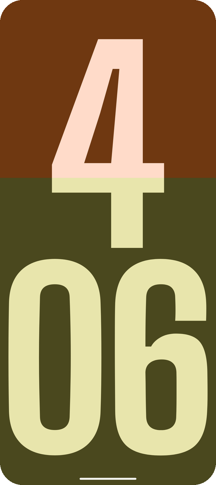
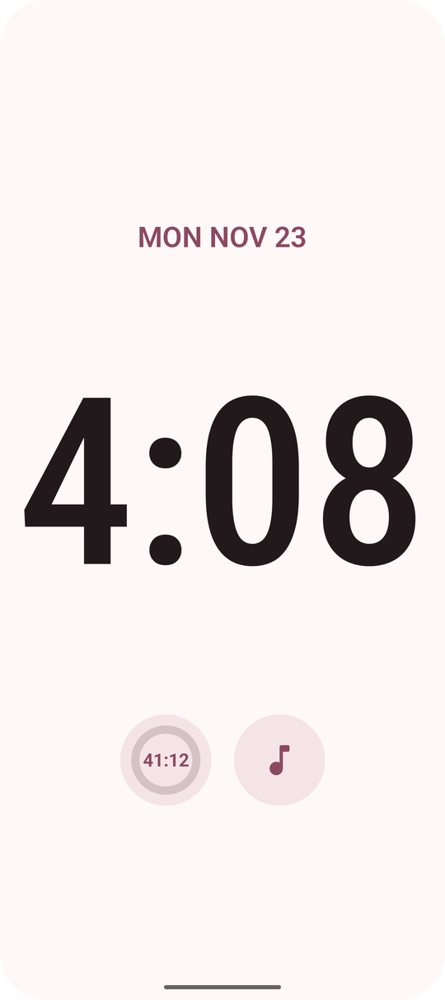
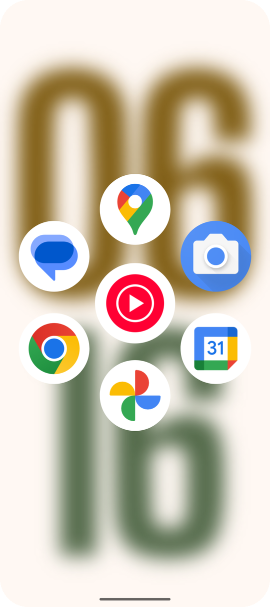
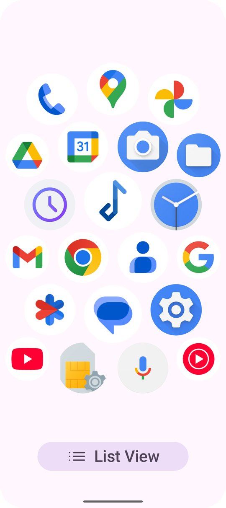
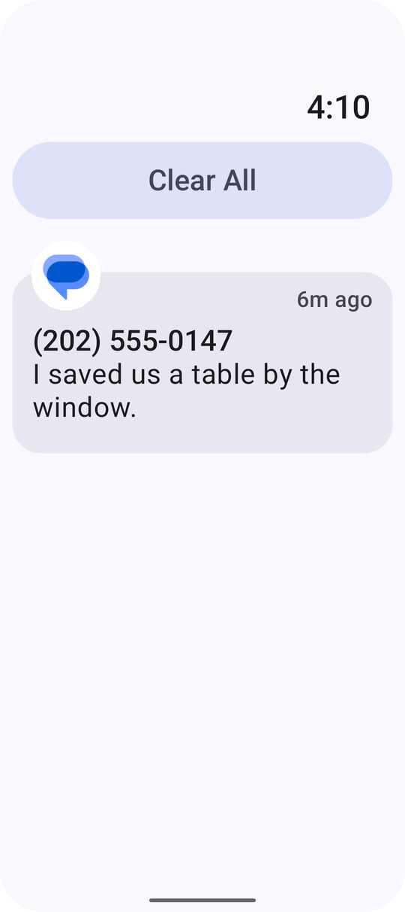

<div align="center">

<picture>
  <source media="(prefers-color-scheme: dark)" srcset="docs/images/logo-dark.svg">
  
</picture>

# Honeycomb

**A watch-style home screen for your Android phone.**

[](https://github.com/advaitpaliwal/honeycomb/releases/latest)
[](LICENSE)
[](#download)

&nbsp;
&nbsp;
&nbsp;
&nbsp;

<br><br>
&nbsp;
&nbsp;
&nbsp;
&nbsp;


</div>

## What is Honeycomb?

Honeycomb is a home screen for Android phones. It is the first thing you see when you unlock your phone.

It works like an Apple Watch. A big watch face fills the screen. Tap it and your seven most used apps pop up in a little cluster. Swipe up and you see what is happening right now, like a running timer or the song that is playing.

Your phone stays the same underneath. Your apps, your messages and your bank app all keep working. You can switch back to your old home screen any time.

## Why I made this

I hate how much of my attention my phone takes up. Every time I unlock it, I get pulled into feeds, badges, and apps I never meant to open.

When I started paying attention to my Apple Watch, I noticed how intentionally minimal watchOS is — you glance at the face, see what matters right now, open the few tools you actually need, and put it away. I wanted that exact calm, focused experience on a bigger screen, without giving up a real smartphone. Honeycomb brings it to Android.

## How it works

| Do this | And you get |
| --- | --- |
| Tap or swipe left on the face | Your seven most used apps in a clean cluster |
| Swipe down on the face | Instant app search (skips straight to the keyboard) |
| Swipe left or tap **All Apps** | Every app in a honeycomb grid or A–Z list view with scrubber & search |
| Swipe up on the face | The Smart Stack: live timers, now playing, and your Android widgets |
| Touch and hold the face | Pick a different face, or edit one |
| Swipe down from the top | Your notifications (from the right side, Control Centre & **Block**) |
| Swipe up from the bottom line | Back to the face from anywhere. On the face itself, your apps |
| Swipe right or Back | Up one level |

There are six faces to pick from: Stacked, Info, Split, Hour, Classic and Plain. Colours, text size and dark mode follow your phone's own settings.

### Built-in Block (Feeds & Websites, 100% offline)

Honeycomb includes an optional **Block** screen (accessible from Control Centre, Honeycomb settings, or the **Block** Quick Settings tile):
- **Short-form feeds & addictive tabs:** Block Instagram Reels/Explore, YouTube Shorts, Snapchat Spotlight, TikTok, and more — or add a pause/limit before opening distracting apps.
- **Zero-network website blocking:** Block distracting domains or toggle built-in categories (Social, News, Video, Shopping, Adult) with per-site controls and custom domains — all locally on-device with no VPN and no internet permission.
- **Strict mode:** Optional 24-hour cooldown before a block rule can be loosened or turned off.

## Download

**[Download the latest APK](https://github.com/advaitpaliwal/honeycomb/releases/latest)** (Android 14 or newer).

### Direct APK install
1. On your phone, open the link above and tap `honeycomb-x.y.z.apk` under **Assets**.
2. Open the downloaded file. If Android asks, allow your browser to install apps.
3. Open Honeycomb. Setup asks to make it your home app, then walks you through the rest one screen at a time. Every step can be skipped.
4. If notification or accessibility access is greyed out, Android is blocking it because the app came from a sideloaded APK. Setup sends you to App info, where you tap **⋮ › Allow restricted settings**.

### Automatic updates with Obtainium
If you use [Obtainium](https://github.com/ImranR98/Obtainium), add `https://github.com/advaitpaliwal/honeycomb` to get automatic release notifications and one-tap updates directly from GitHub Releases.

**To go back,** open Settings › Apps › Default apps › Home app, pick your old home screen, then uninstall Honeycomb.

No root, no bootloader unlock and no account. Honeycomb only uses Android's normal home app role.

## Privacy

Honeycomb does **not** request the `INTERNET` permission, so Android itself prevents it from sending anything off your phone. There are no accounts, ads, telemetry, or analytics, and it opts out of Android's cloud backup (`android:allowBackup="false"`).

| Permission | Why |
| --- | --- |
| Home app role | To be your home screen |
| See all apps (`QUERY_ALL_PACKAGES`) | To list every app you can open |
| Usage access (optional) | To rank your 7 most used apps. Without it, Honeycomb counts launches locally |
| Notification access (optional) | For Notification Centre, Now Playing and live timers in the Smart Stack |
| Do Not Disturb access (optional) | For the Quiet button in Control Centre (media audio stays unmuted) |
| Wi‑Fi state | To show whether Wi‑Fi is on in Control Centre |
| Modify system settings (optional) | For the brightness slider in Control Centre |
| Accessibility, "Honeycomb Block" (optional, off until you turn it on) | To block short-form feeds, pause distracting apps, and block websites in your browser locally on-device |

## FAQ

**Why should I trust an APK that asks for Accessibility or Notification access?**
You don't have to take anyone's word for it:
1. Honeycomb has **zero `INTERNET` permission** in [`AndroidManifest.xml`](launcher/src/main/AndroidManifest.xml). Android enforces at the OS level that it cannot make network requests.
2. Every sensitive permission (Usage, Notifications, DND, Write Settings, Accessibility) is **100% optional** and skippable during setup — the launcher works fine without them.
3. The entire codebase is open source under Apache 2.0, and release APKs are built transparently by [GitHub Actions](.github/workflows/release-app.yml) with SHA-256 checksums published alongside every release.

**Why Android 14+ only?**
Honeycomb uses modern Android 14–16 launcher, widget, and Live Update APIs and targets edge-to-edge Material 3 Expressive styling without legacy compatibility shims. If you're on Android 13 or older, the APK will not install.

**Does Block need a VPN or root?**
No. **Honeycomb Block** runs locally using Android's Accessibility service (when you opt in), so it blocks short-form feeds inside apps (like Reels and Shorts) and blocked websites in your browser without hijacking your VPN slot or routing traffic anywhere.

**What happens to my existing apps, banking apps, and widgets?**
Nothing changes underneath. Honeycomb is just a standard Android home app (`ROLE_HOME`). Your apps, banking/Play Integrity checks, notifications, and Android home screen widgets (added via the Smart Stack's **Edit** button) all work normally.

**Why is "Allow restricted settings" needed for Notifications or Block?**
Android 13+ automatically restricts Notification Listener and Accessibility toggles for any sideloaded APK (anything not installed from the Play Store). Tapping **App info › ⋮ › Allow restricted settings** once unlocks those toggles.

**Will this come to Google Play or F-Droid?**
Google Play is on the roadmap once the cross-device testing pass is complete. Until then, GitHub Releases (or [Obtainium](https://github.com/ImranR98/Obtainium) for automatic updates) is the official channel.

**Does Honeycomb drain battery or keep anything running in the background?**
No background network syncing, no analytics, and no wake locks. Watch faces only tick while the screen is on and Honeycomb is visible.

**How do I switch back to my old home screen?**
Open **Settings › Apps › Default apps › Home app**, pick your previous launcher (e.g. Pixel Launcher or One UI Home), and uninstall Honeycomb. Nothing is permanently modified.

## Build from source

You need JDK 17 and the Android SDK, with `ANDROID_HOME` set.

```sh
git clone https://github.com/advaitpaliwal/honeycomb.git
cd honeycomb
./gradlew :launcher:assembleApp
adb install -r launcher/build/outputs/apk/app/launcher-app.apk
adb shell cmd package set-home-activity org.honeycomb.launcher/.LauncherActivity
```

Tests:

```sh
./gradlew :launcher:testDebugUnitTest
# device tests run only on the honeycomb-a16 emulator
ANDROID_SERIAL=emulator-5554 bash scripts/test-launcher-device.sh
```

To set up a phone over USB with a one-command undo, see [docs/setup-phone.md](docs/setup-phone.md).

## Contributing

Issues and pull requests are welcome. Read [CONTRIBUTING.md](CONTRIBUTING.md) first, and see [docs/design-language.md](docs/design-language.md) for how the screens are built.

## License

Honeycomb is released under the [Apache License 2.0](LICENSE).

## Credits

- [Big Shoulders Display](https://fonts.google.com/specimen/Big+Shoulders+Display) for the watch digits, under the [SIL Open Font License 1.1](licenses/BigShouldersDisplay-OFL.txt).
- [Inter](https://rsms.me/inter/) for text, under the SIL Open Font License 1.1.
- [Feedcut](https://github.com/Yxonyx/feedcut) for the feed pause, under the Apache License 2.0.

Full notices are in [NOTICE](NOTICE). Honeycomb is not affiliated with Apple.
