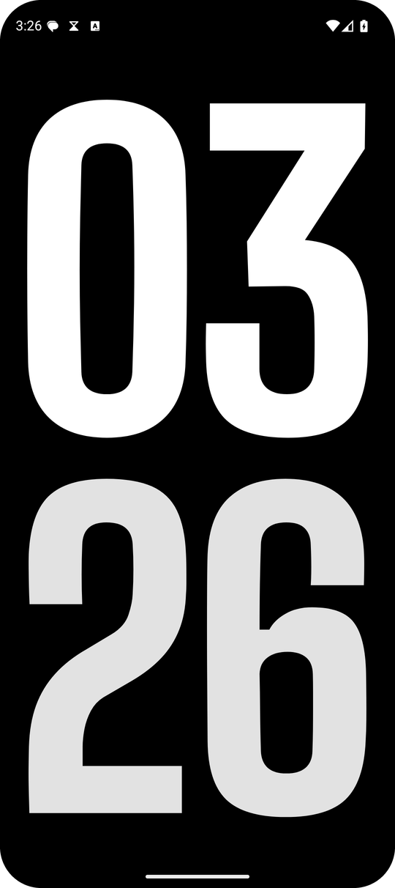
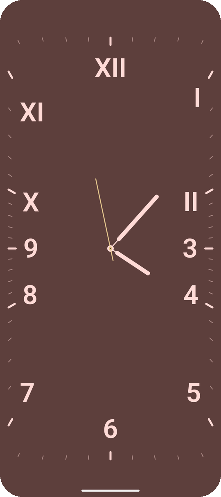
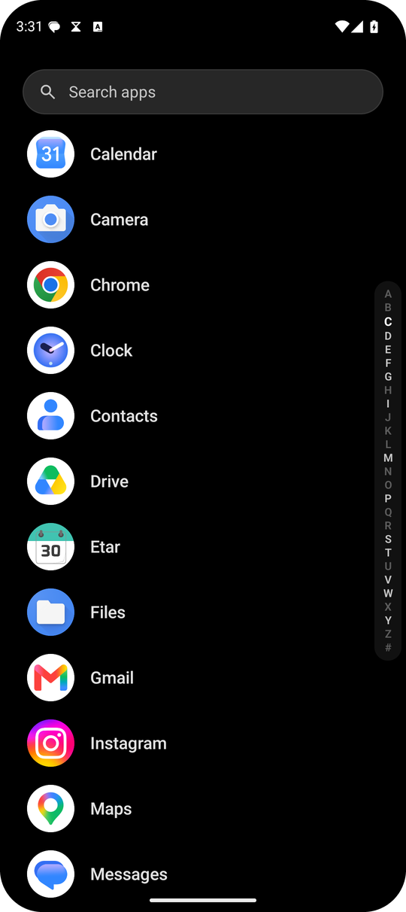
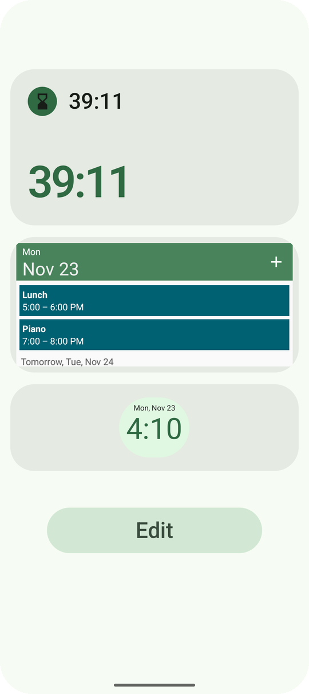
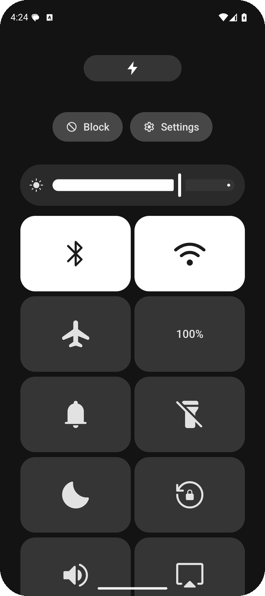
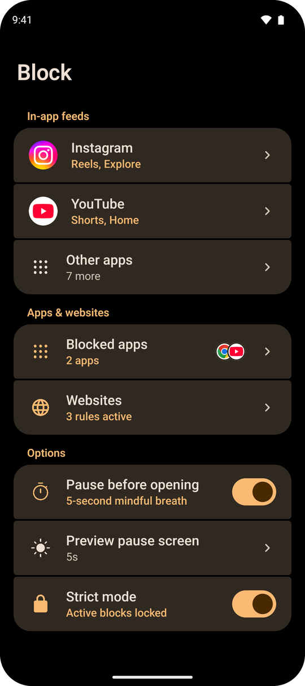
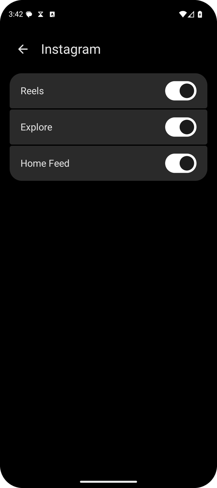
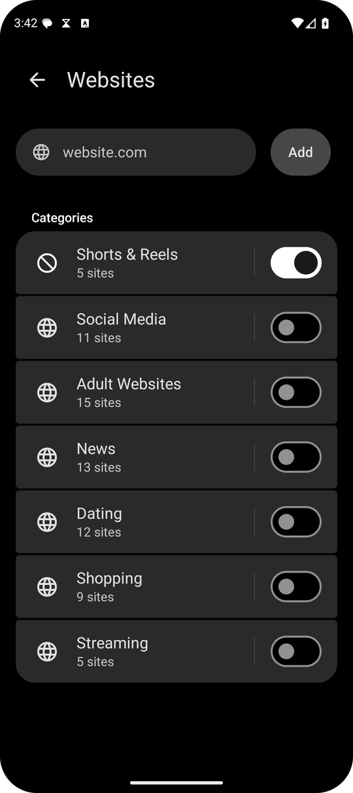

<div align="center">

<picture>
  <source media="(prefers-color-scheme: dark)" srcset="docs/images/logo-dark.svg">
  
</picture>

# Honeycomb

**A watch-style home screen for your Android phone.**

[](https://github.com/advaitpaliwal/honeycomb/releases/latest)
[](LICENSE)
[](#download)

&nbsp;
&nbsp;
&nbsp;
&nbsp;

<br><br>
&nbsp;
&nbsp;
&nbsp;
&nbsp;


</div>

## What is Honeycomb?

Honeycomb is a home screen for Android phones. It is the first thing you see when you unlock your phone.

It works like an Apple Watch. A big watch face fills the screen. Tap it and your seven most used apps pop up in a little cluster. Swipe up and you see what is happening right now, like a running timer or the song that is playing.

Your phone stays the same underneath. Your apps, your messages and your bank app all keep working. You can switch back to your old home screen any time.

## Why I made this

I hate how much of my attention my phone takes up. Every time I unlock it, I get pulled into feeds, badges, and apps I never meant to open.

When I started paying attention to my Apple Watch, I noticed how intentionally minimal watchOS is — you glance at the face, see what matters right now, open the few tools you actually need, and put it away. I wanted that exact calm, focused experience on a bigger screen, without giving up a real smartphone. Honeycomb brings it to Android.

## How it works

| Do this | And you get |
| --- | --- |
| Tap or swipe left on the face | Your seven most used apps in a clean cluster |
| Swipe down on the face | Instant app search (skips straight to the keyboard) |
| Swipe left or tap **All Apps** | Every app in a honeycomb grid or A–Z list view with scrubber & search |
| Swipe up on the face | The Smart Stack: live timers, now playing, and your Android widgets |
| Touch and hold the face | Pick a different face, or edit one |
| Swipe down from the top-right (just below the status bar) | Control Centre: Brightness slider, **Block**, Settings, and quick toggles |
| Swipe down from the top-left | Notification Centre |
| Swipe up from the bottom line | Back to the face from anywhere. On the face itself, your apps |
| Swipe right or Back | Up one level |
| Search `"block"`, `"brightness"`, or `"settings"` | Jump straight to Block, Control Centre, or Honeycomb Settings |

There are six faces to pick from: Stacked, Info, Split, Hour, Classic and Plain. Colours, text size and dark mode follow your phone's own settings.

### Built-in Block (Feeds & Websites, 100% on-device)

Honeycomb includes a built-in **Block** app right in your app grid (and in Control Centre & Quick Settings):
- **Short-form feeds & addictive tabs:** Block Instagram Reels/Explore, YouTube Shorts, Snapchat Spotlight, TikTok, and more — or add a pause/limit before opening distracting apps.
- **Zero-VPN website blocking:** Block distracting domains or toggle built-in categories (Social, News, Video, Shopping, Adult) with per-site controls and custom domains — all locally on-device with no VPN and no external server.
- **Strict mode:** Optional 24-hour cooldown before a block rule can be loosened or turned off.

<div align="center">
&nbsp;&nbsp;
&nbsp;&nbsp;

</div>

## Download

**[Download the latest APK](https://github.com/advaitpaliwal/honeycomb/releases/latest)** (Android 14 or newer).

### Direct APK install & built-in updates
1. On your phone, open the link above and tap `honeycomb-x.y.z.apk` under **Assets**.
2. Open the downloaded file. If Android asks, allow your browser to install apps.
3. Open Honeycomb. Setup asks to make it your home app, then walks you through the rest one screen at a time. Every step can be skipped.
4. If notification or accessibility access is greyed out, Android is blocking it because the app came from a sideloaded APK. Setup sends you to App info, where you tap **⋮ › Allow restricted settings**.
5. **Stay up to date in one tap:** Honeycomb checks GitHub Releases automatically (or anytime from **Control Centre › Settings › Updates**), verifies the release SHA-256 checksum, and hands the signed APK directly to Android's package installer.

### Updates with Obtainium
If you prefer managing sideloaded apps with [Obtainium](https://github.com/ImranR98/Obtainium), add `https://github.com/advaitpaliwal/honeycomb` to track releases there too.

**To go back,** open Settings › Apps › Default apps › Home app, pick your old home screen, then uninstall Honeycomb.

No root, no bootloader unlock and no account. Honeycomb only uses Android's normal home app role.

## Privacy & Permissions

Honeycomb is open source under Apache 2.0 with **no accounts, no tracking, and no ads**. It only goes online to check GitHub Releases for app updates, and normal Android backup keeps your watch face, layout, and Block rules if you switch phones. Every permission below is optional except the home app role.

| Permission | Why |
| --- | --- |
| Home app role | To be your home screen |
| See all apps (`QUERY_ALL_PACKAGES`) | To list every app you can open |
| Internet (`INTERNET`) | To check for and download updates from GitHub Releases |
| Install packages (optional) | To install an update when you tap it |
| Usage access (optional) | To rank your 7 most used apps (otherwise Honeycomb counts launches locally) |
| Notification access (optional) | For Notification Centre, Now Playing, and live timers in the Smart Stack |
| Do Not Disturb access (optional) | For the Quiet toggle in Control Centre |
| Modify system settings (optional) | For the Brightness slider in Control Centre |
| Accessibility, "Honeycomb Block" (optional, off by default) | To block short-form feeds (Reels, Shorts) and websites locally on-device |

## FAQ

**Why Android 14+ only?**
Honeycomb uses modern Android 14–16 launcher, widget, and Live Update APIs without legacy shims.

**Does Block need a VPN or root?**
No. **Honeycomb Block** runs locally using Android's Accessibility service when you turn it on, so your VPN slot stays free.

**Why is "Allow restricted settings" needed for Notifications or Block?**
Android 13+ automatically restricts Notification and Accessibility toggles for apps installed outside Google Play. Tapping **App info › ⋮ › Allow restricted settings** once unlocks them.

**What happens to my existing apps, banking apps, and widgets?**
Nothing changes underneath. Honeycomb is just a normal Android home app — your banking apps, Google Wallet, RCS, and widgets all work normally.

**Will this come to Google Play or F-Droid?**
Yes, both are on the roadmap. Until then, GitHub Releases (or [Obtainium](https://github.com/ImranR98/Obtainium)) is the easiest way to install and update.

**How do I switch back to my old home screen?**
Open **Settings › Apps › Default apps › Home app**, pick your previous launcher, and uninstall Honeycomb.

## Build from source

You need JDK 17 and the Android SDK, with `ANDROID_HOME` set.

```sh
git clone https://github.com/advaitpaliwal/honeycomb.git
cd honeycomb
./gradlew :launcher:assembleApp
adb install -r launcher/build/outputs/apk/app/launcher-app.apk
adb shell cmd package set-home-activity org.honeycomb.launcher/.LauncherActivity
```

Tests:

```sh
./gradlew :launcher:testDebugUnitTest
# device tests run only on the honeycomb-a16 emulator
ANDROID_SERIAL=emulator-5554 bash scripts/test-launcher-device.sh
```

To set up a phone over USB with a one-command undo, see [docs/setup-phone.md](docs/setup-phone.md).

## Contributing

Issues and pull requests are welcome. Read [CONTRIBUTING.md](CONTRIBUTING.md) first, and see [docs/design-language.md](docs/design-language.md) for how the screens are built.

## License

Honeycomb is released under the [Apache License 2.0](LICENSE).

## Credits

- [Big Shoulders Display](https://fonts.google.com/specimen/Big+Shoulders+Display) for the watch digits, under the [SIL Open Font License 1.1](licenses/BigShouldersDisplay-OFL.txt).
- [Inter](https://rsms.me/inter/) for text, under the SIL Open Font License 1.1.
- [Feedcut](https://github.com/Yxonyx/feedcut) for the feed pause, under the Apache License 2.0.

Full notices are in [NOTICE](NOTICE). Honeycomb is not affiliated with Apple.
